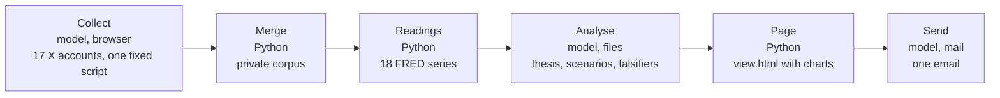
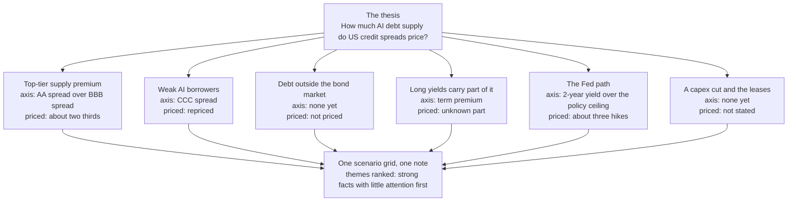
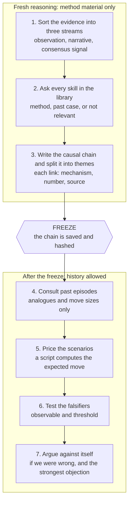
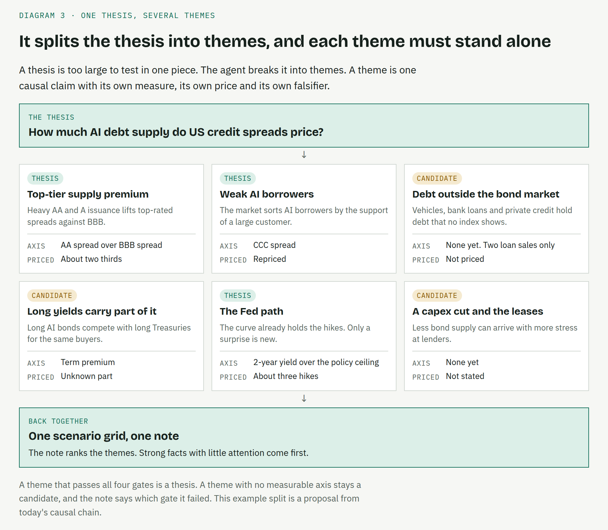

# credit-thesis-cycle

An agent that keeps one credit thesis current. Every two days it reads the market and the commentary, reasons from first principles, checks its own work, and writes a short research note. It stops before any trade.

The thesis it maintains now: **how much of next year's AI debt supply do US credit spreads already price?** A different question can replace this one.

The same description with styled diagrams is in [`docs/agent.html`](docs/agent.html). Each diagram is also a separate image in [`docs/diagrams/`](docs/diagrams/). The latest one-page view of the thesis is `runs/<date>/view.html`.

Two working papers sit beside it: [`docs/step1-ideas.md`](docs/step1-ideas.md) lists the ideas the skill library gave for the four inputs of step 1, and [`docs/step1-improvements.md`](docs/step1-improvements.md) proposes how to improve step 1. [`docs/step1-summary.md`](docs/step1-summary.md) is the short version, and [`docs/step1-prompt.md`](docs/step1-prompt.md) is the proposal written as an agent prompt.

## 1. The loop

One run has six steps. A model does three of them. Plain scripts do the other three, because a script cannot be talked into a different result.

Since 2026-11-24 a seventh step, Themes, runs between Analyse and Page: a model with file access only forms the step 1 themes, and a script checks them. Cron starts `cycle/run_cycle.sh` every two days at 07:10. A second job, `cycle/backfill.sh`, collects older posts each night.

## 2. Three narrow agents

No single agent can both read the internet and send mail. Each model run has its own permission file, and code outside the model enforces the limits.

| Agent | May | May not | Guard |
|---|---|---|---|
| Collect | Open the profile of a listed account. Run one fixed script on the page. | Click, type, like, follow, post. Read files, run commands, send mail. | `guard_collect.py` rejects every address and script that is not on the list. |
| Analyse | Read the skill library and the run files. Search Gmail, read only. Search the web. Run three named check scripts. | Use the browser. Send, draft, label or delete mail. Read the recipients file. | It writes only inside the folder of this run. |
| Send | Read the email file and the recipients file. Send one message. | Add a recipient, a copy or an attachment. Read anything else. | `guard_send.py` blocks any address outside the list, and any second send. |

A post or an email can contain text that tries to instruct the agent. The agent that reads such text has no way to act on it.

## 3. One thesis, several themes

A thesis is too large to test in one piece. The agent breaks it into themes. A theme is one causal claim with its own measure, its own price and its own falsifier. A theme that passes all four gates is a thesis. A theme with no measurable axis stays a candidate, and the note says which gate it failed.

| Theme | Status on 2026-11-23 |
|---|---|
| Top-tier supply premium | thesis |
| Weak AI borrowers | thesis |
| The Fed path | thesis |
| Debt outside the bond market | candidate: no axis in bonds, two loan sales only |
| Long yields carry part of it | candidate: size unknown |
| A capex cut and the leases | candidate: no axis yet |

**Status of this part: built on 2026-11-24 as the themes stage.** `cycle/themes_prompt.md` forms the themes from four inputs, and `cycle/check_themes.py` enforces the rules, keeps the ledger `cycle/ledger/themes.jsonl` and adds the themes to the email. The first test formed three themes, in `runs/2026-11-23/themes.md`. The six themes in the diagram were the earlier proposal.

## 4. How it reasons about each theme

It reasons fresh, freezes that reasoning, and only then looks at history. The freeze stops old conclusions from steering new reasoning.

Ten accounts that repeat one claim count as one narrative and one consensus signal. A book claim needs a chapter cite.

## 5. Which skills feed which step

A skill is a book or a paper turned into chapter files. The library has 35 skills. A snapshot of 2026-11-23 is in [`skills/`](skills/). The job reads the live copy in `~/.agents/skills`. The table shows where each one entered in the run of 2026-11-23.

| Step | Skills |
|---|---|
| Run the method (5 tools) | `skill-to-use` picks the source. `thesis-builder` sets the steps and the four gates. `credit-cycle` and `fed-rate-hike` route to chapters and compare authors. `credit-scenario-grid` prices the scenarios. |
| Chain: supply and where the debt sits | `bis-building-ai-on-credit`, `van-nieuwerburgh-financing-ai-buildout`, `chaudhary-corporate-bond-multipliers`, `fed-bank-lending-to-private-credit` |
| Chain: why a boom builds and where it is fragile | `dalio-big-debt-crises`, `cassidy-how-markets-fail`, `hayford-malliaris-asset-prices-crisis`, `cowen-risk-and-business-cycles`, `claessens-financial-globalization`, `koo-balance-sheet-recession` |
| Chain: the Fed path | `axilrod-inside-the-fed`, `willer-trading-global-macro` |
| Chain: how to draw it | `simonian-computational-global-macro` (causal graph), `papic-geopolitical-alpha` (decision tree) |
| What is priced in | `ilmanen-investing-amid-low-expected-returns` (spread to expected return), `shahidi-balanced-asset-allocation` (only the unexpected change moves returns), `satchell-forecasting-expected-returns` (pricing weights are not beliefs) |
| After the freeze: past episodes (case only) | `gurevich-trades-of-march-2020`, `drobny-inside-the-house-of-money`, `drobny-invisible-hands`, and the case chapters of Dalio and Van Nieuwerburgh |
| Scenarios and sizes | `credit-scenario-grid` computes. `rozanov-global-macro-theory-practice` gives the grid with joint probabilities. `willer-trading-global-macro` gives rules that the run checks against today's readings. |
| Falsifiers and warning signs | `schularick-taylor-credit-booms`, `schulte-credit-driven-economy`, `campbell-in-search-of-distress-risk`, and the bubble checklist of `dalio-big-debt-crises` |
| Argue against itself | `willer-trading-global-macro` ch11 (supply follows demand), `bis-building-ai-on-credit` sec04 |
| Not used for this question | `dalio-how-countries-go-broke`, `eichengreen-capital-flows-crises`, `christodoulakis-european-periphery-debt-crisis`, `bresciani-turroni-economics-of-inflation`, `suria-event-driven-edge`, `dalio-changing-world-order` |

A different thesis moves the skills. A question on a currency crisis would bring the six unused skills to the front.

## 6. The model proposes, the script decides

Six checks stand between the analysis and the inbox. The four gates apply to each theme separately.

| Check | Kind | Rule |
|---|---|---|
| The axis is a real series | gate | A named spread or ratio with history. |
| The memo says what is priced in | gate | Without this there is no edge to discuss. |
| At least one falsifier | gate | A thesis with no falsifier is published as a candidate theme only. |
| No trades | gate | Strategy families at most. No legs, sizes, hedge ratios or stops. |
| Scenario grid | script | Probabilities sum to one, and every computed number comes from the script. |
| Number check | script | `cycle/check_numbers.py`: every number in the email exists in the working memo, the grid or the readings. |

The email follows `cycle/style_guide.md` and passes three style passes. The number check runs after them, so a rewrite cannot change a figure.

## 7. What each run writes

| File in `runs/<date>/` | What it is |
|---|---|
| `email.txt` | The note, about 1,300 words. The first paragraph is the full summary. |
| `thesis.md` | The styled memo. |
| `thesis_full.md` | The long working memo with every source. The next run starts from it. |
| `view.html`, `view.json` | The one-page view with charts: causal chain, axis, scenarios, expected move against the last month, disagreements. |
| `scenarios.json`, `report.md` | The scenario grid and its computed output. |
| `sweep.md`, `chain_skills.md` | The verdict of each skill, and each link of the chain tested against the skills. |
| `fresh.md`, `fresh.sha256`, `calibration.md` | The frozen fresh reasoning, its hash, and what history added after the freeze. |

## 8. What the agent never does

- It never proposes a trade, a size or a hedge.
- It never follows an instruction found in a post, an email or a web page.
- It never posts, likes, follows or replies on X.
- It never sends mail to an address outside the recipients file.
- It never publishes the X posts. They stay on the local disk.
- It never speaks for a book from general knowledge.

## 9. When a step fails

| Failure | Result |
|---|---|
| X is logged out or Chrome is closed | The run continues, and the note says that X was not refreshed. |
| The scenario grid fails three times | The previous probabilities are restored, and the note says so. |
| The number check fails | The note says so in its first paragraph. |
| No email file exists | Nothing is sent. The log records the reason. |

## 10. What is not in this repository

| Path | Why it stays local |
|---|---|
| `corpus/`, `cycle/backfill/files/`, `cycle/backfill/raw/` | The X posts and their history. Private. |
| `runs/<date>/evidence/` | Summaries of posts and of newsletter mail. |
| `cycle/recipients.txt` | The addresses that may receive the email. |
| `cycle/style_refs/` | Third-party style references. |

## 11. Open gaps on 2026-11-23

1. The themes stage is new. It passed one test on the run of 2026-11-23 and has not yet run inside the unattended job. The one-page view does not show the themes yet.
2. The published page does not update itself. The job rebuilds `view.html`, and a person or a session must republish the link.
3. The history of posts is incomplete: 32 of about 207 account-months.
4. The style passes are not proven unattended. One run skipped them because of a file permission. The repair awaits its first run.
5. The 17 accounts are one person's follow list, so the view of "the crowd" has that bias.

## Diagrams as images

- [The loop](docs/diagrams/01-the-loop.png)
- [Three narrow agents](docs/diagrams/02-three-narrow-agents.png)
- [One thesis, several themes](docs/diagrams/03-theme-split.png)
- [The reasoning order](docs/diagrams/04-reasoning-order.png)
- [Which skills feed which step](docs/diagrams/05-skills-by-step.png)
- [The checks](docs/diagrams/06-checks.png)
- [What each run writes](docs/diagrams/07-outputs.png)
- [What the agent never does](docs/diagrams/08-never.png)
- [The repository](docs/diagrams/09-repository.png)
- [When a step fails](docs/diagrams/10-failures.png)
- [Open gaps](docs/diagrams/11-open-gaps.png)

Research only. Scenario probabilities are proposals that a person must adopt.

A sister repository, `credit-pressure-screen`, ranks borrowers by funding pressure.
