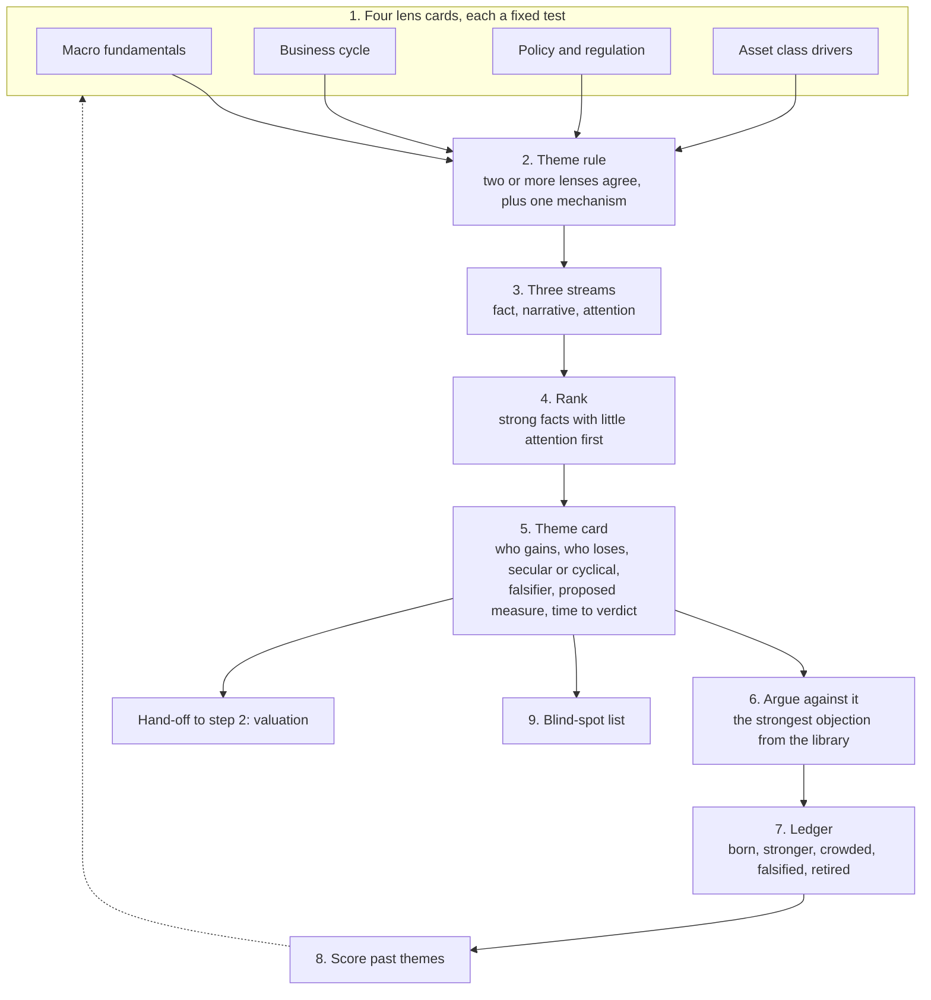

# How to improve step 1, the development of views

A proposal, written on 2026-11-23. Nothing in this file is built yet.

## What step 1 is today

Step 1 of the four-step process lists four inputs and one output:

- Inputs: macroeconomic fundamentals, the business cycle, monetary and fiscal conditions with regulation, and the drivers of asset class performance.
- Output: specific market themes.

## Where step 1 is weak

Step 1 is a list of topics to discuss. It does not say how a theme forms, how to tell a strong theme from a weak one, or how to learn from past themes.

| Weakness | Consequence |
|---|---|
| The inputs are topics, not tests. | Two people can discuss the same input and reach no comparable result. |
| No rule for how inputs become a theme. | A theme can rest on one input and one story. |
| Consensus is named but not measured. | Nobody knows when a view became crowded. |
| No falsifier at the theme stage. | A theme cannot fail, so it never leaves the list. |
| No memory. | The process does not learn which kinds of theme were right. |
| No statement of what was not looked at. | Blind spots stay invisible. |

## Nine improvements

1. **Turn each input into a lens card.** A card has one question, the series that answer it, the method from a named skill, today's reading and its direction. Example for the policy lens: "does the curve already hold the path?", answered by the 2-year yield against the policy ceiling.
2. **Give theme formation a rule.** A theme needs findings from at least two lenses that point the same way, and one mechanism that connects them. A finding from one lens alone is an observation, not a theme.
3. **Keep three streams apart.** A fact is dated and sourced. A narrative is an author's causal claim. Attention is evidence of what the crowd watches. Ten sources that repeat one claim count once.
4. **Rank by facts against attention.** Strong facts with little attention come first. Heavy attention with thin facts marks a crowded story. This puts a number on "has our view become consensus".
5. **Write one card for each theme.** The card states the theme in one sentence, who gains and who loses, whether it is secular or cyclical, a falsifier with an observable and a threshold, a proposed measure for step 2, and the time by which the theme should be confirmed or rejected.
6. **Argue against each theme.** Two fixed paragraphs: what would be true if the theme were wrong, and the strongest objection from the library.
7. **Keep a ledger.** Each theme has a status across runs: born, stronger, crowded, falsified or retired. The ledger also records how attention moved.
8. **Score past themes.** After the verdict date, record whether the theme held and how early it was against attention. The process then learns which lenses and sources lead.
9. **List the blind spots.** Each run states which lens had no data, which regions it did not cover, and which skills were unused. Today the list would name European credit, the loan to deposit ratio, and a source set drawn from one follow list.

## What stays out of step 1

Pricing belongs to step 2. Step 1 proposes a measure for each theme and stops there. It does not estimate what is priced in, and it does not run scenarios.

## How to tell that step 1 improved

| Measure | Today | Target |
|---|---|---|
| Themes with a falsifier | The single thesis has four. Themes have none. | Every theme has at least one. |
| Themes that rest on two or more lenses | Not recorded | All of them |
| Attention at the birth of a theme | Not recorded | Recorded, and low for the top-ranked themes |
| Past themes with a verdict | None | All themes past their verdict date |
| Blind spots stated | In prose, sometimes | A fixed list in each run |

## Build order, smallest first

1. Lens cards and theme cards as one file for each run, `themes.json`, with a script that checks the theme rule and the required fields.
2. The ledger across runs.
3. An attention count from the post corpus and the newsletter evidence.
4. Scoring of past themes, once the first verdict dates pass.
5. Wider coverage: European series and a second, independent set of sources.

## What the existing job already gives

The three narrow agents, the freeze before history, the skill sweep, the number check and the email all stay. Steps 3, 4 and 6 above exist today for one thesis. The work is to apply them to several themes and to add the lens cards, the ledger and the scoring.

Research only. No trades.
